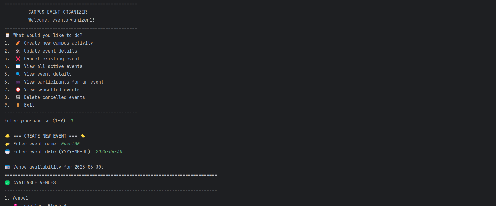
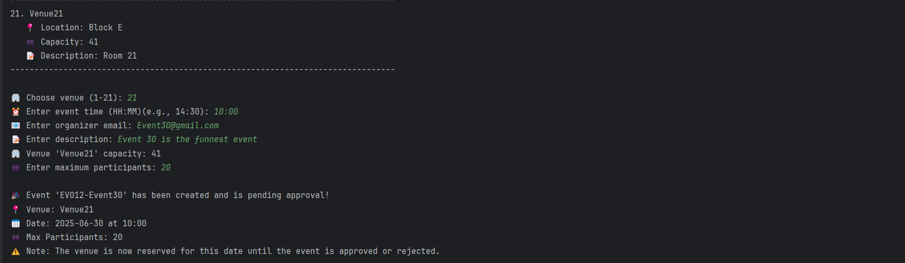
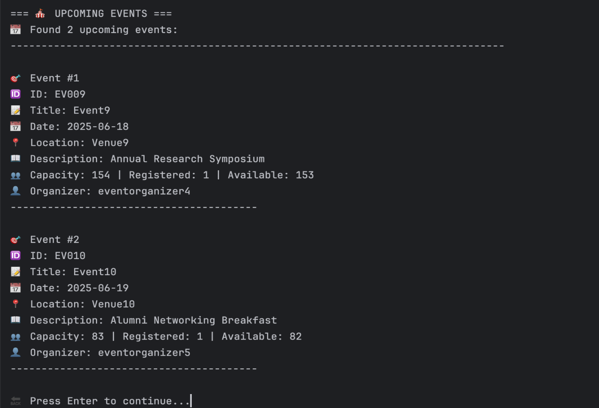
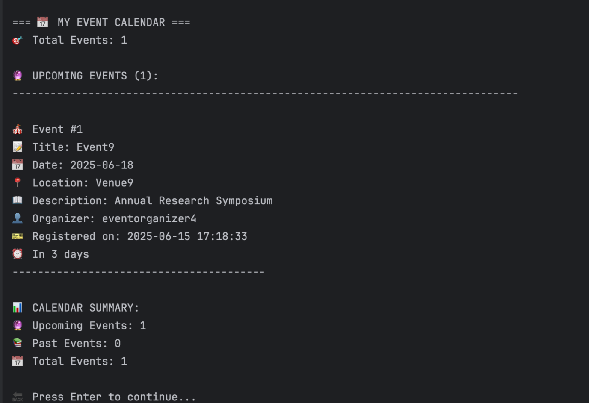
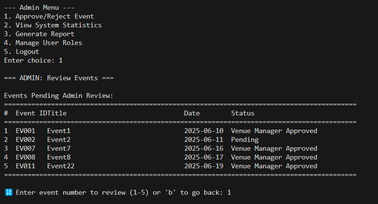
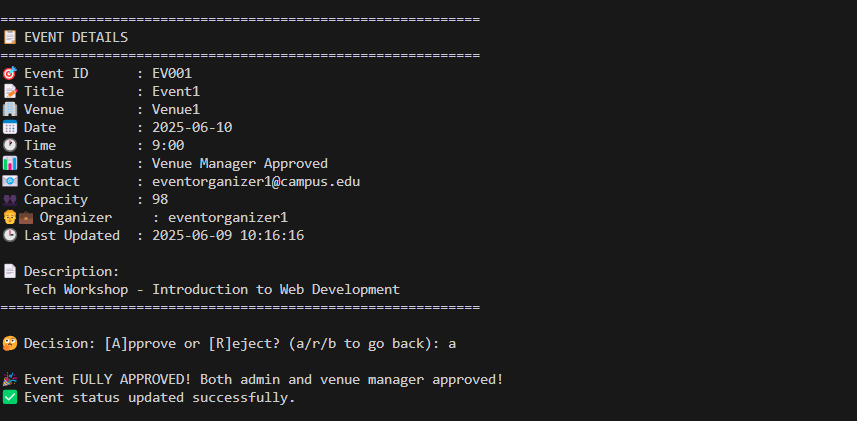
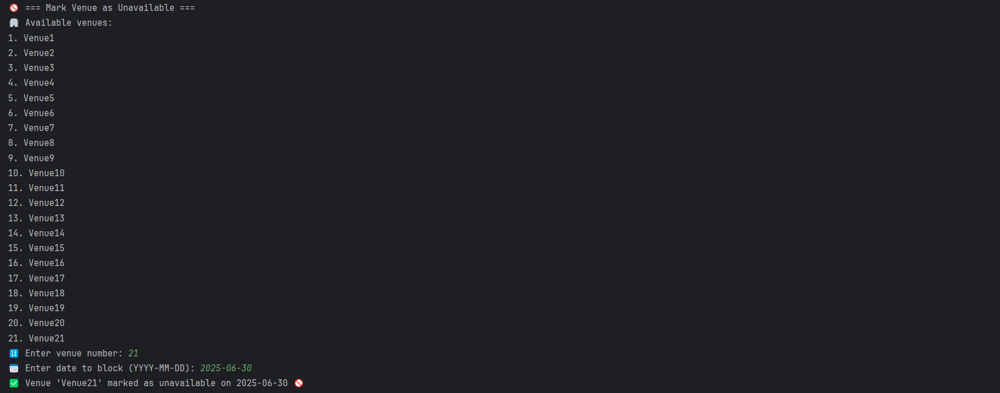
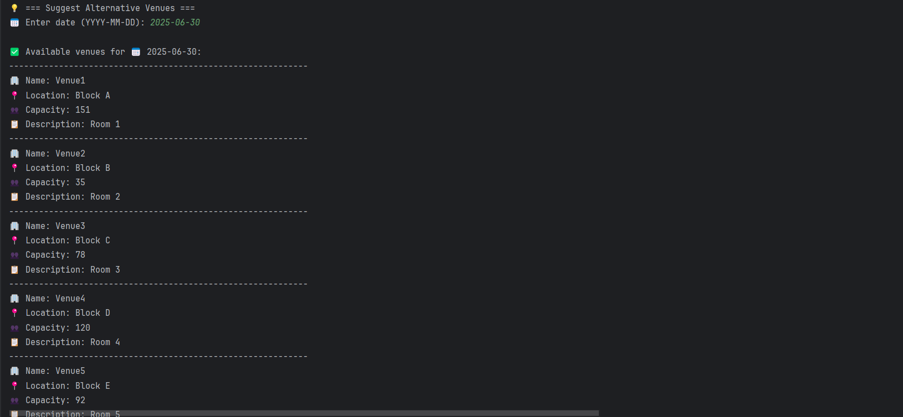

# Smart Campus Event Management System

A menu-driven Python console application for running campus events. Students and lecturers sign up, organizers propose events, venue managers and administrators approve them in two steps, and participants browse, register and keep a personal calendar. Every booking is checked against venue availability, so a venue is never double-booked.

Built as a group project (Group 19) for a Python programming assignment at Asia Pacific University (APU). It uses only the Python standard library and **plain text files** for storage, so there is nothing to install.

## Features

### Event Organizer
- Create an event: the system lists the venues that are free on the chosen date, and the maximum number of participants cannot exceed the venue's capacity
- Update or cancel an event, view active events and event details, and view the participants of an event
- View and delete cancelled events

### Participant
- Browse upcoming events (only fully approved ones are shown, with the seats left), or search by title, date or location
- Register for an event, with a check that places are still available, and cancel a registration
- View a personal calendar with upcoming and past events

### Venue Manager
- View venue availability for a date and a monthly venue calendar
- Add and delete venues, block a venue on a date and unblock it again
- Approve or reject venue booking requests, and get suggestions for alternative venues
- Export a venue booking report for a date range

### Administrator
- Approve or reject events
- View system statistics and generate a report (`report.txt`)
- Manage user roles and view all users

### Accounts and approval flow
- Sign up and log in. A **Student** can be a Participant or an Event Organizer, and a **Lecturer** can be a Venue Manager or an Administrator. An Event Organizer can also switch to the Participant screens.
- Passwords need at least 8 characters with a letter and a number, and are stored as SHA-256 hashes. Emails and usernames are validated and must be unique.
- An event needs **both** approvals before it goes ahead:

```
pending ──► venue_manager_approved ─┐
   │                                ├──► fully_approved
   └──────► admin_approved ─────────┘
 (either approver can also reject: rejected_by_venue_manager / rejected_by_admin)
```

## Screenshots

| | |
|---|---|
|  |  |
| *Event Organizer: create an event and see the free venues* | *Choosing a venue; the event is saved as pending* |
|  |  |
| *Participant: browse upcoming events with seats left* | *Participant: personal event calendar* |
|  |  |
| *Administrator: events waiting for review* | *Administrator: the second approval makes the event fully approved* |
|  |  |
| *Venue Manager: block a venue on a date* | *Venue Manager: venues that are free on a date* |

## Project structure

```
.
├── Smart_Campus_Event_Management_System.py   Entry point: sign up, log in, role menus
├── event_organizer.py                        Event Organizer features
├── participant.py                            Participant features
├── venue_manager.py                          Venue Manager features
├── admin.py                                  Administrator features
├── users.txt  events.txt  venues.txt         Data files (sample data included)
├── registrations.txt  blocked_dates.txt  cancelled_events.txt
└── docs/screenshots/
```

About 4,200 lines of Python. Each role has its own module, and the main file opens the right one after login.

## Data storage

All data lives in `|`-separated text files in the folder the program is started from, so **run it from the repository root**:

| File | Holds |
|---|---|
| `users.txt` | username, email, password hash, base role, functional role, created time |
| `events.txt` | event name, venue, date, time, status, timestamps, contact email, event ID, description, capacity, organizer |
| `venues.txt` | name, capacity, location, description |
| `registrations.txt` | username, event ID, time, status (Active or Cancelled) |
| `blocked_dates.txt` | venue and blocked date |
| `cancelled_events.txt` | events removed by their organizer |

The app also writes `report.txt` (administrator report) and `booking_report_<from>_<to>.txt` (venue manager export). Both are ignored by git.

## Getting started

You need **Python 3** (tested with 3.13). Then, from the repository root:

```bash
python Smart_Campus_Event_Management_System.py
```

### Demo accounts

All accounts and data are fictional. Every seeded account uses the password **`abc123456`**.

| Role | Usernames |
|---|---|
| Participant | `participant1` to `participant5` |
| Event Organizer | `eventorganizer1` to `eventorganizer5` |
| Venue Manager | `venuemanager1` to `venuemanager5` |
| Administrator | `administrator1` to `administrator5` |

The sample events are dated in July 2025, so they now count as past events. Create a new event with a future date as an Event Organizer to see the whole flow: approve it as a Venue Manager and as an Administrator, then register for it as a Participant. The app saves every change straight back to the text files, so use `git restore .` to get the sample data back.

## Known limitations

- Text-only interface, and one user at a time. Two people editing the same file together are not handled.
- SHA-256 hashes have no salt. A real system should use a slow, salted hash such as bcrypt.
- A venue is checked by date only, so it can host one event per day. Events have a start time but no end time.
- Changing a user's role goes through text-file edits behind a menu, with no undo or audit log.

## Team

| Role | Member |
|---|---|
| Event Organizer | [@xiulailai](https://github.com/xiulailai) |
| Venue Manager | [@xiulailai](https://github.com/xiulailai) |
| Participant | [@2FoR1](https://github.com/2FoR1) |
| Administrator | [@WilliamChuah](https://github.com/WilliamChuah) |

## License

Released under the [MIT License](LICENSE). Copyright (c) 2026 automaticicemaker Contributors and APU.
